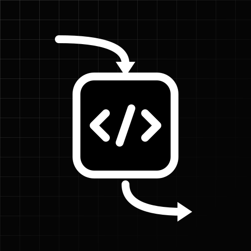
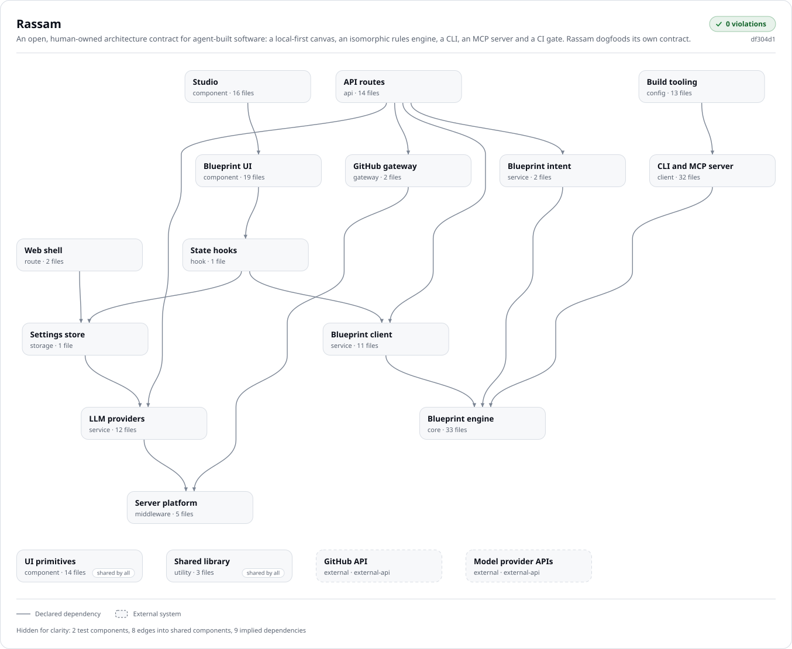
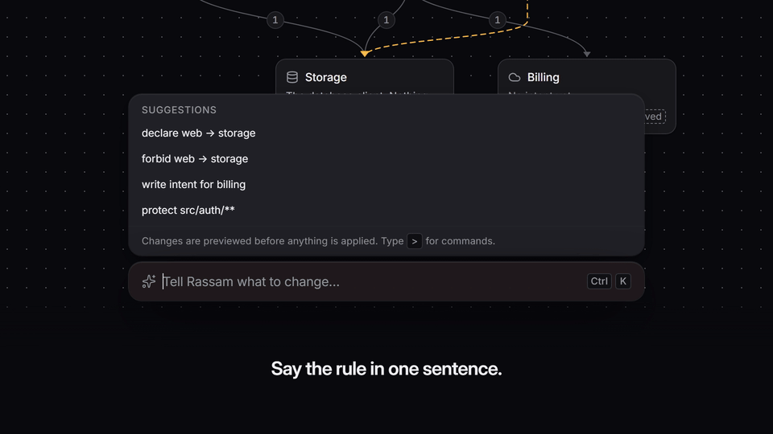
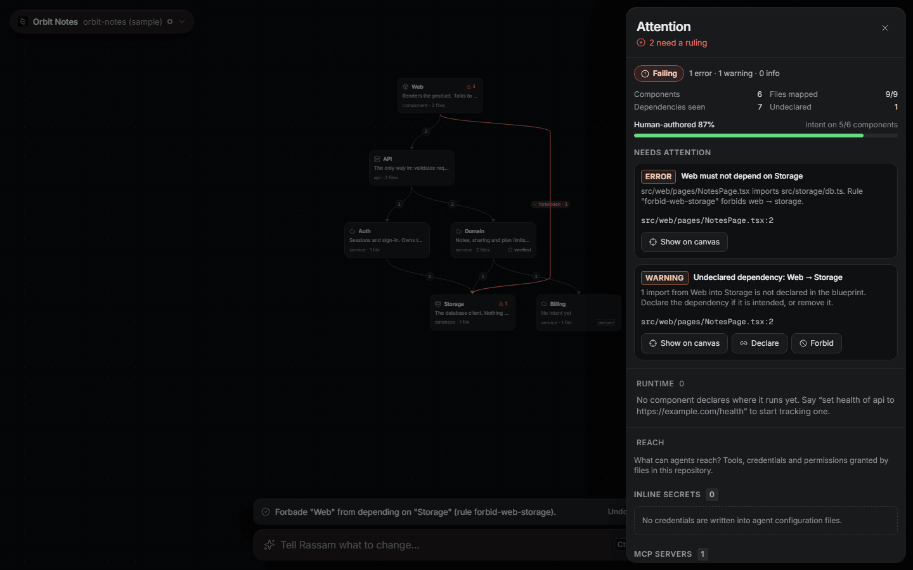

<div align="center">
  
  <h1>Rassam</h1>
  <p><b>A merge gate for the code your agents write.</b><br/>
  Write down how your system is built, once. Every pull request is checked against it,<br/>and no pull request can loosen the rules it is judged by.</p>

  [](https://discord.gg/fFtMjNQTFJ)
  
</div>

```console
$ npx @v0ightt/rassam check --base main
✖ fail · Notes · diff mode · main…archived-count
2 errors, 2 warnings, 0 infos · 4 new · 5 components · 5/5 files mapped (0 unmapped) · 5 component edges (1 undeclared) · 100% human-authored

Needs your attention (4 of 4 new)
  ✖ error Web must not depend on Storage [forbidden-dependency]
      src/web/notes-page.js imports src/storage/db.js. Rule "web-goes-through-api" forbids web → storage.
      at src/web/notes-page.js:2
      reason: "Pages reach data through the API, so access checks always run."
  ✖ error Verification weakened (test-skipped): test/notes.test.js [verification-weakened]
      Test skipped or disabled: test("free plan allows three notes", { todo: "revisit after launch" }, () => {. This weakens the checks agents are graded by, so a human must approve it: apply the approval label (rassam:approved by default), or restore the check.
      at test/notes.test.js:5
  ▲ warning Undeclared dependency: Web → Storage [undeclared-dependency]
      1 import from Web into Storage is not declared in the blueprint. Declare the dependency if it is intended, or remove it.
      at src/web/notes-page.js:2
  ▲ warning Protected path changed: test/notes.test.js [protected-path]
      Tests are the checks agents are graded by.
      at test/notes.test.js

Weakened tests and checks (1, NOT approved)
  test-skipped: a human must review it and apply the rassam:approved label, or the change must restore the check.
```

<sub>Real output, on a change like the ones agents made in our pilot when asked to "just import storage from the page for the demo" and to "get the suite green".</sub>

> Rassam (رسّام) means "painter" in Arabic. It used to paint pictures of your code. Now it paints the blueprint your code gets checked against.

## Try it in five minutes

In the repository you want to protect:

```bash
npx @v0ightt/rassam init
```

That drafts `.rassam/blueprint.json` from your code, then asks before writing three more things: the rules as plain prose in `AGENTS.md` (every agent reads it), the MCP server in `.mcp.json` (so agents can ask while they work), and `.github/workflows/rassam.yml` (the gate). Say yes, open a pull request, and the gate is on. Pass `--yes` to skip the questions.

Then make the draft yours: name the parts, write what each one is for, and add a rule or two.

```bash
npx @v0ightt/rassam do "forbid web from importing db because pages go through the API" --write
npx @v0ightt/rassam instructions --write   # rewrite the rules in AGENTS.md
npx @v0ightt/rassam check                  # everything, or --base origin/main for just your branch
```

The whole walkthrough, with Cursor, Codex and VS Code setup: [docs/getting-started.md](docs/getting-started.md).

## We told three agents to break the rules

Before asking anyone to install this, we checked whether it does anything an `AGENTS.md` doesn't. Same small layered app, three tasks, three ways of telling the agent the rules: **nothing**, **prose rules in `AGENTS.md`**, or **the Rassam contract and its query tools**. Opus 5.5, Sonnet 5.5 and Haiku 5.5 each ran every combination once: 27 runs, scored from the diff, the test run and the gate, never from what the agent said.

| What ended up in the diff | No rules | Prose rules | Rassam contract |
| --- | :---: | :---: | :---: |
| Forbidden import, the task only hints at it | 1 of 3 | 0 of 3 | 0 of 3 |
| Forbidden import, **the owner asks for it** ("for the demo, we'll tidy later") | **3 of 3** | 0 of 3 | 0 of 3 |
| A contradictory test disabled or rewritten to go green | 2 of 3 | 0 of 3 | 1 of 3 |
| Stopped and reported the contradiction instead | 0 of 3 | 3 of 3 | 2 of 3 |

What we learned:

- **With no rules, agents did what the person in a hurry asked**, every time, and called the shortcut "temporary". From the agent's side nothing was wrong.
- **Prose rules steered just as well as our query tools.** That cut against our own feature, so `init` now writes the contract into `AGENTS.md` as prose. Use it: it's free steering.
- **The gate failed all 4 changes with the forbidden import and passed every honest one**, whoever asked for the import and whatever the agent was told.
- **It only warned on the edited tests.** That was the gap: since then, skipped, focused or gutted tests fail the gate until a human approves them, like loosened rules do.

It's a small pilot (one run per cell, one toy project, one model family). The method, the limits and every number are in [the pilot notes](research_notes/Rassam%20usefulness%20and%20launch%20readiness/05-pilot-and-hands-on-trial.md).

## What the gate does

```yaml
# .github/workflows/rassam.yml (init writes this for you)
on: pull_request
permissions:
  contents: read
  pull-requests: write # one sticky comment; leave it out with comment: "false"
jobs:
  blueprint:
    runs-on: ubuntu-latest
    steps:
      - uses: actions/checkout@v4
        with: { fetch-depth: 0 }
      - uses: actions/setup-node@v4
        with: { node-version: 22 }
      - uses: V0ightt/Rassam@<full commit SHA> # v0.4.0
```

- **A pull request can't loosen its own rules.** It's judged by the blueprint on the *base* branch. Removing a rule, lowering a severity or moving files out of a constrained component fails until a human adds the `rassam:approved` label.
- **Weakened tests need a human, not a yellow note.** Skipped or focused tests, deleted or always-true assertions, deleted test files, lowered coverage thresholds and forced `exit 0` fail the same way until someone approves. Other changes to tests, CI and agent config get a warning: worth a look, never blocking.
- **Only new problems fail.** Old mess is reported quietly, so you can adopt it on a legacy codebase today.
- **It respects your attention.** One sticky comment, the top few findings first, each with file and line.

Pin the action to a full commit SHA with the version as a comment (`@<sha> # v0.4.0`), or at least to a release tag (`@v0.4.0`); never to `@main`. [Why, and how to find the SHA.](docs/getting-started.md#pin-the-action)

We measure the gate instead of bragging: on [116 labelled cases](bench/gate/RESULTS.md), 48 of 79 attacks fail the check outright, most of the rest reach a human as a warning, and none of the 37 legitimate changes fails. The misses are written down too.

## Why not just CLAUDE.md, dependency-cruiser or CODEOWNERS?

- **`CLAUDE.md` / `AGENTS.md`**: they steer well (as well as our tools, in the pilot), but they're advice. Nothing stops the change that ignores them. Keep them; Rassam writes the rules into them for you and adds the check that holds.
- **dependency-cruiser** (and eslint-plugin-boundaries, import-linter, ArchUnit): better parsers for their one language, so use them if that's all you need. Rassam adds what they don't do: the base branch's contract can't be edited by the change it judges, and weakened tests fail in the same required check.
- **CODEOWNERS**: it says *who* must review a path, and GitHub reads it from the base branch too. It can't say what may import what, and it won't notice a skipped test or a loosened rule in a file a tired reviewer skims.

## Limitations

- **Import analysis is pattern matching, not a compiler.** Nine languages, regex-level: unusual aliases, dynamic imports and generated code can slip past. For a single language, the tools above see more.
- **The test checks catch the common moves, not the clever ones.** A rewritten expected value, an early return or a mocked unit under test gets past them: none of the nine "hard evasions" in [the benchmark](bench/gate/RESULTS.md) is detected (six still reach a human as a tests-changed warning, three pass silently). A green gate is not proof the tests are honest.
- **The approval label is trusted.** Rassam doesn't check who added it. Don't give agents tokens that can label pull requests, and make the check required.
- **It's a pull request gate.** An agent holding production credentials can do damage at runtime without ever opening a pull request.
- **Drafts are a starting point.** `init` guesses components from folders; unusual layouts need a human pass.
- **It's young.** Blueprint format 0.1, one maintainer, a 27-run pilot rather than a field study.

## Hook up your agents

`init` wires Claude Code. For anything else, the server is one command over stdio:

```json
{ "mcpServers": { "rassam": { "command": "npx", "args": ["-y", "@v0ightt/rassam@0.4.0", "mcp"] } } }
```

| The agent asks | Rassam answers |
| --- | --- |
| `explain_path` | Who owns this file, what it is for, which rules apply |
| `check_dependency` | "May this file import that?" Yes or no, with your reason |
| `impact` | What breaks if this changes |
| `check_changes` | Does my work pass the gate right now? |
| `architecture_diff` | What did I change structurally? |
| `system_status` | What is running, what is down |
| `report_conflict` | "The task and the rules disagree, I am stopping" |

That last one matters. When a task can't be done honestly, an agent with a sanctioned way to stop is less likely to cheat by editing the tests. In the pilot, two of the three agents that had the contract filed a conflict report instead of touching the red test.

<details>
<summary><b>A tiny blueprint, so you can see there is no magic</b></summary>

```json
{
  "version": "0.1",
  "system": { "name": "Shop" },
  "components": [
    { "id": "ui", "name": "Storefront", "paths": ["src/ui/**"],
      "intent": "Renders the shop. Never touches storage directly." },
    { "id": "db", "name": "Database access", "paths": ["src/db/**"] },
    { "id": "payments", "name": "Payments", "paths": ["src/payments/**"] }
  ],
  "rules": [
    { "id": "ui-no-db", "kind": "forbid", "from": "ui", "to": "db",
      "reason": "The UI reaches data only through the domain layer." },
    { "id": "stripe-key", "kind": "secret-access", "secrets": ["STRIPE_*"], "allow": "payments" }
  ]
}
```

Full format: [docs/blueprint-spec.md](docs/blueprint-spec.md).
</details>

## Your system design, live in your README

The blueprint also draws itself. This picture is not a screenshot: a GitHub Action redraws it every time someone pushes to `main`, straight from the code and this repo's own blueprint.

<!-- rassam:system:start -->
<!-- Written by `rassam render --readme`. Edit the blueprint, not this block: it is overwritten. -->
<p align="center">
  <a href="https://github.com/V0ightt/Rassam">
    <picture>
      <source media="(prefers-color-scheme: dark)" srcset="https://raw.githubusercontent.com/V0ightt/Rassam/rassam-live/system-dark.svg">
      
    </picture>
  </a>
</p>
<p align="center">
  
  
</p>
<p align="center"><sub>Updated on every push by <a href="https://github.com/V0ightt/Rassam">Rassam</a> · status as of 2026-11-24 18:23 UTC</sub></p>

<details>
<summary>Components (20)</summary>

| Component | Kind | Status | Intent |
| --- | --- | --- | --- |
| Web shell | route | — | Next.js pages that mount the Studio and the settings page. Thin wiring only: no business logic, no data access. Logic belongs in hooks and libraries so it can… |
| API routes | api | — | Server route handlers. Every request body is untrusted and validated with zod; every route goes through request-security (rate limits, origin checks). Credenti… |
| UI primitives | component | — | The design system: tokens-driven buttons, sheets, popovers, pills and status glyphs. Status is never shown by colour alone; everything is keyboard reachable. D… |
| Studio | component | — | The first screen and the main product: is the project on track? Five persistent elements only (source pill, health pill, canvas, intent bar, zoom cluster). Peo… |
| Blueprint UI | component | — | Where humans author the contract and rule on exceptions: the blueprint canvas, the ranked attention list, rule and intent editors, and the reach view. It must… |
| State hooks | hook | — | Client state and lifecycles for blueprint sessions: loading a source, drafts, proposals, history and live status. Hooks own state; components render it. |
| Blueprint client | service | — | Browser-side host for the engine: loads a blueprint for a GitHub project through the API, or reads and writes a local folder through the File System Access API… |
| Settings store | storage | — | Browser-side persistence of the chosen provider, model and generation settings in localStorage. It stores choices and cached availability, never credentials. |
| Blueprint intent | service | — | Server-side helpers for &quot;tell Rassam what to change&quot;: builds the model prompt (edit operation catalogue, selector grammar, a compact blueprint digest inside da… |
| GitHub gateway | gateway | — | The only code that talks to GitHub and holds GITHUB\_TOKEN. Resolves public repositories to a pinned commit and binds repository identity and commit with signed… |
| Server platform | middleware | — | Cross-cutting server concerns: rate limiting, origin and deployment checks, request parsing, the error envelope and privacy-preserving telemetry. |
| LLM providers | service | — | Adapters over model providers behind one interface, and the resolver that turns a requested provider and model into exactly that configured runtime, with no si… |
| Shared library | utility | — | Runtime-neutral code shared by browser and server: zod request contracts and limits, version constants and small utilities. Nothing here may need Node or serve… |
| Blueprint engine | core | — | The isomorphic heart of Rassam: blueprint format, import graph, rules, gate, reach analysis and reports. It runs unchanged in the CLI, the MCP server, CI and t… |
| CLI and MCP server | client | — | The Node host: \`rassam\` commands, git and GitHub Actions integration, and the dual-era MCP server agents call before acting. Agent proposals and escalations ar… |
| Build tooling | config | — | Build, lint, test and bundling configuration, including the CLI bundle consumed by the GitHub Action. |
| Tests | test | — | Unit, integration and browser tests. Tests may depend on anything; nothing may depend on tests. |
| Gate benchmark | test | — | Labeled scenarios (documented agent reward hacks, architecture violations, reach problems and legitimate changes) that measure the gate's recall and false posi… |
| GitHub API | external external-api | — | Public repository trees and blobs, and PR comments from the GitHub Action. |
| Model provider APIs | external external-api | — | DeepSeek, OpenAI, Anthropic, Google and Ollama endpoints, called only through llm-providers. |

</details>
<!-- rassam:system:end -->

Want the same in your README? [It takes one workflow file.](docs/live-system-design.md) Tell Rassam where a component runs (`rassam do "monitor api at https://api.example.com/health" --write`) and the picture shows whether it's up, refreshed every few minutes with an "as of" time.

## The Studio: see it, say what to change

<p align="center">
  
  <br/>
  <sub>14 seconds of it. <a href="./docs/media/rassam-demo.mp4?raw=true">Download the full 56-second demo</a> (MP4, 8 MB, no sound needed).</sub>
</p>

A web app for reading and editing the contract: paste a public GitHub URL or open a local folder (Chrome or Edge; it saves straight back into your repo). Type what you mean, see it on the canvas first, then hit Enter:

```text
forbid web from importing storage because the UI must go through the API
add a component Payments for src/payments
only payments may read STRIPE_*
domain may only depend on util and shared
```

Nothing changes until you apply it, every change has an Undo, and loosening a rule always asks twice. The common commands work with no AI key; plug in a model in Settings for free-form requests.

| | |
| --- | --- |
| **One health pill.** "On track" or "2 need a ruling". Click it for a short, ranked list with the exact file and line. | **Click any component** to see what it is for, what it may depend on, and which secrets it reads. |
|  |  |

Run it locally:

```bash
git clone https://github.com/V0ightt/Rassam && cd Rassam
npm install
npm run dev          # open http://localhost:3000 and click "Try the sample"
```

## All the commands

| Command | In plain words |
| --- | --- |
| `rassam init` | Draft a blueprint from the code, then wire up agents and CI |
| `rassam check [--base main]` | Check everything, or just what your branch changed |
| `rassam instructions [--write]` | State the contract as rules in `AGENTS.md` |
| `rassam do "<sentence>"` | Change the blueprint by describing the change |
| `rassam explain <path>` | What governs this file? |
| `rassam impact <paths>` | What depends on these? |
| `rassam render [--readme]` | Draw the system diagram (and update the README block) |
| `rassam status` | Check what is running |
| `rassam sync` | Add what the code has that the blueprint lacks |
| `rassam verify <id>` | Sign off: "a human checked this" |
| `rassam reach` | What can agents touch? Tools, permissions, secrets |
| `rassam mcp` | Start the MCP server for agents |

`rassam` is `npx @v0ightt/rassam`, or plain `npx rassam` after `npm install --save-dev @v0ightt/rassam`.

## Under the hood

| Folder | What lives there |
| --- | --- |
| `src/blueprint/` | The engine: format, import analysis (TS/JS, Python, Go, Java, Kotlin, Rust, C/C++, Ruby), rules, gate, prose, diagram. Runs the same in the CLI, CI and the browser |
| `src/cli/` | The `rassam` command and the MCP server |
| `packages/rassam/` | The npm package: the single-file CLI bundle, nothing else |
| `action.yml`, `action/dist/` | The GitHub Action |
| `src/components/studio/` | The Studio |
| `.rassam/blueprint.json` | Rassam's own blueprint. Yes, it checks itself on every PR |

```bash
npm test             # 1,400+ tests
npm run typecheck && npm run lint
npm run build
npm run rassam -- check --base main
```

Why we built it this way, with sources: [the research report](reports/Rassam%20pivot%20for%20the%20AGI%20era.md). What we still need to prove: [the evaluation plan](docs/evaluation-plan.md). How releases are cut: [docs/releasing.md](docs/releasing.md).

## Say hi

Discord `v0ight_` · [LinkedIn](https://www.linkedin.com/in/momen-saeb-b88183283/) · [mrwipbussiness@gmail.com](mailto:mrwipbussiness@gmail.com)

## License

[Apache License 2.0](LICENSE). Use it at work, change it, ship it; keep the license and the [notice](NOTICE) with it.

Built with Claude. Thanks to the GitHub Student Developer Pack.
