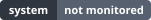
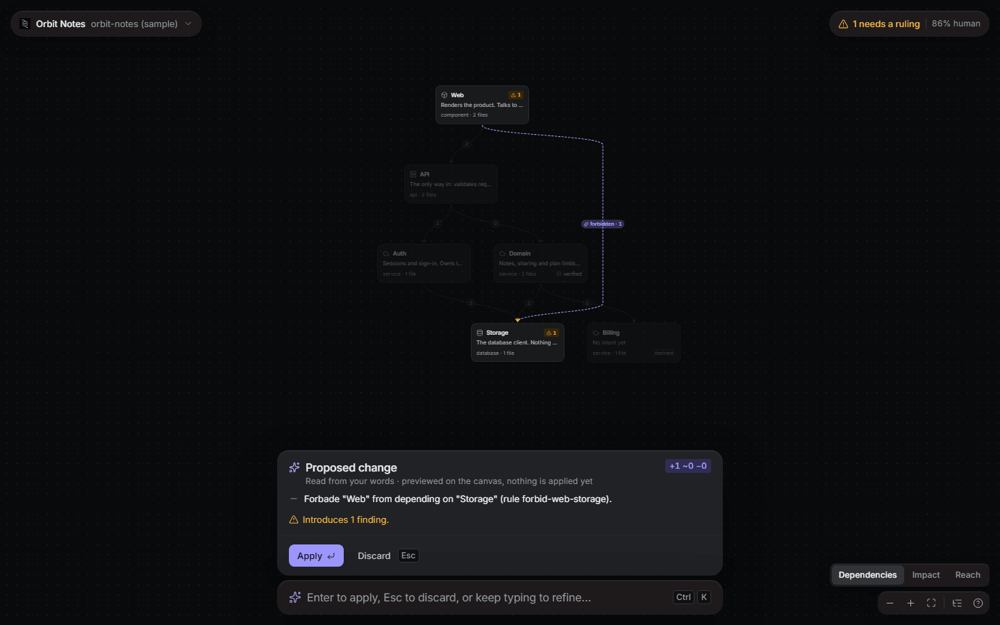
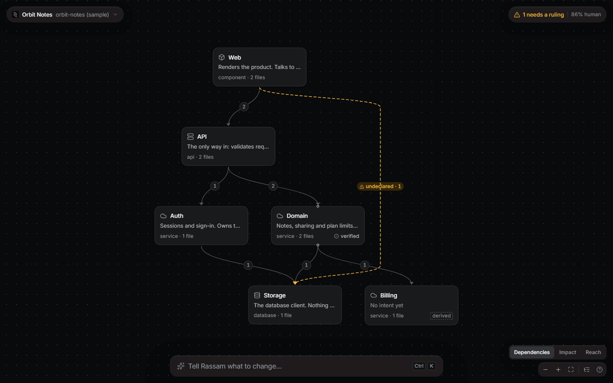
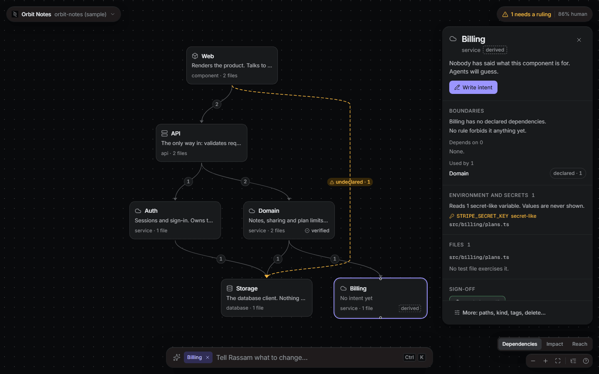
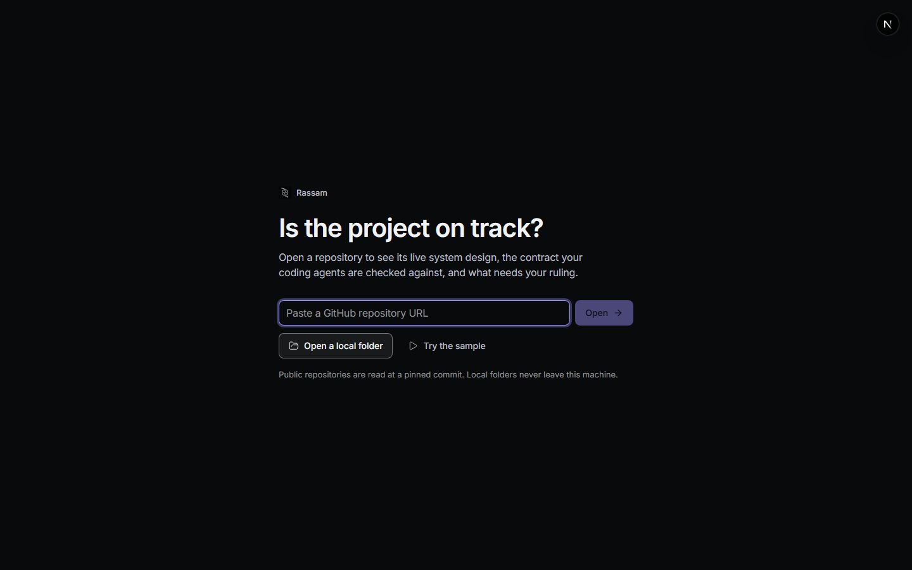
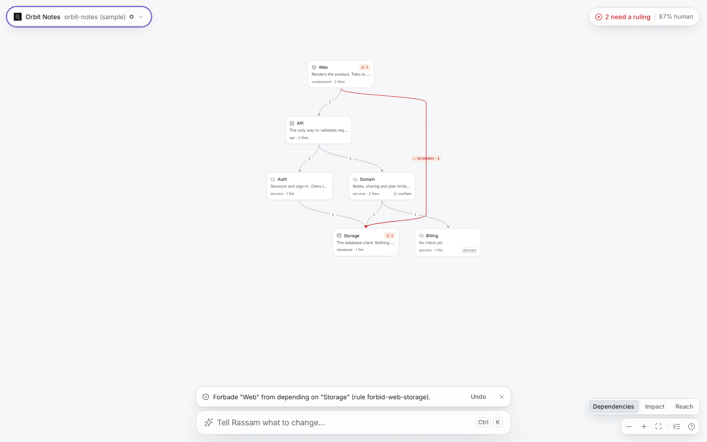

<div align="center">
  
  <h1>Rassam</h1>
  <p><b>Is your project still on track?</b><br/>
  One place where you and your coding agents check before changing anything.</p>

  [](https://discord.gg/fFtMjNQTFJ)
  
</div>

<p align="center">
  
  <br/>
  <sub>That was 14 seconds of it. <a href="./docs/media/rassam-demo.mp4?raw=true">Download the full 56-second demo</a> (MP4, 8 MB, no sound needed).</sub>
</p>

> Rassam (رسّام) means "painter" in Arabic. It used to paint pictures of your code. Now it paints the blueprint your code gets checked against.

> [!NOTE]
> Rassam is young and moving fast. The blueprint format is versioned (`0.1`), so your files stay valid as it grows.

## So, what is this?

Agents write a lot of your code now. That part got easy. The hard part is knowing whether all those changes still add up to the system you actually wanted.

Rassam fixes that with one small file in your repo, `.rassam/blueprint.json`. Think of it as the house rules for your codebase:

- **what the parts are** ("this folder is the payments service")
- **what each part is for**, in your own words
- **what may talk to what** ("the UI never touches the database")
- **who may hold which secrets** ("only payments reads the Stripe key")

Then three things happen on their own:

1. **Your agents ask before they act.** Claude Code, Codex, Cursor and friends query the blueprint over MCP: *may I import this from here?*
2. **Every pull request gets checked.** If a change breaks a rule, weakens a test, or quietly loosens the rules themselves, you hear about it.
3. **Your README shows the real system.** A diagram of your architecture that redraws itself on every push.

You stay the author. Agents do the typing.

## This repo's own system design, live

This picture is not a screenshot. A GitHub Action redraws it every time someone pushes to `main`, straight from the code and this repo's own blueprint.

<!-- rassam:system:start -->
<!-- Written by `rassam render --readme`. Edit the blueprint, not this block: it is overwritten. -->
<p align="center">
  <a href="https://github.com/V0ightt/Rassam">
    <picture>
      <source media="(prefers-color-scheme: dark)" srcset="https://raw.githubusercontent.com/V0ightt/Rassam/rassam-live/system-dark.svg">
      
    </picture>
  </a>
</p>
<p align="center">
  
  
</p>
<p align="center"><sub>Updated on every push by <a href="https://github.com/V0ightt/Rassam">Rassam</a> · status as of 2026-11-24 18:23 UTC</sub></p>

<details>
<summary>Components (20)</summary>

| Component | Kind | Status | Intent |
| --- | --- | --- | --- |
| Web shell | route | — | Next.js pages that mount the Studio and the settings page. Thin wiring only: no business logic, no data access. Logic belongs in hooks and libraries so it can… |
| API routes | api | — | Server route handlers. Every request body is untrusted and validated with zod; every route goes through request-security (rate limits, origin checks). Credenti… |
| UI primitives | component | — | The design system: tokens-driven buttons, sheets, popovers, pills and status glyphs. Status is never shown by colour alone; everything is keyboard reachable. D… |
| Studio | component | — | The first screen and the main product: is the project on track? Five persistent elements only (source pill, health pill, canvas, intent bar, zoom cluster). Peo… |
| Blueprint UI | component | — | Where humans author the contract and rule on exceptions: the blueprint canvas, the ranked attention list, rule and intent editors, and the reach view. It must… |
| State hooks | hook | — | Client state and lifecycles for blueprint sessions: loading a source, drafts, proposals, history and live status. Hooks own state; components render it. |
| Blueprint client | service | — | Browser-side host for the engine: loads a blueprint for a GitHub project through the API, or reads and writes a local folder through the File System Access API… |
| Settings store | storage | — | Browser-side persistence of the chosen provider, model and generation settings in localStorage. It stores choices and cached availability, never credentials. |
| Blueprint intent | service | — | Server-side helpers for &quot;tell Rassam what to change&quot;: builds the model prompt (edit operation catalogue, selector grammar, a compact blueprint digest inside da… |
| GitHub gateway | gateway | — | The only code that talks to GitHub and holds GITHUB\_TOKEN. Resolves public repositories to a pinned commit and binds repository identity and commit with signed… |
| Server platform | middleware | — | Cross-cutting server concerns: rate limiting, origin and deployment checks, request parsing, the error envelope and privacy-preserving telemetry. |
| LLM providers | service | — | Adapters over model providers behind one interface, and the resolver that turns a requested provider and model into exactly that configured runtime, with no si… |
| Shared library | utility | — | Runtime-neutral code shared by browser and server: zod request contracts and limits, version constants and small utilities. Nothing here may need Node or serve… |
| Blueprint engine | core | — | The isomorphic heart of Rassam: blueprint format, import graph, rules, gate, reach analysis and reports. It runs unchanged in the CLI, the MCP server, CI and t… |
| CLI and MCP server | client | — | The Node host: \`rassam\` commands, git and GitHub Actions integration, and the dual-era MCP server agents call before acting. Agent proposals and escalations ar… |
| Build tooling | config | — | Build, lint, test and bundling configuration, including the CLI bundle consumed by the GitHub Action. |
| Tests | test | — | Unit, integration and browser tests. Tests may depend on anything; nothing may depend on tests. |
| Gate benchmark | test | — | Labeled scenarios (documented agent reward hacks, architecture violations, reach problems and legitimate changes) that measure the gate's recall and false posi… |
| GitHub API | external external-api | — | Public repository trees and blobs, and PR comments from the GitHub Action. |
| Model provider APIs | external external-api | — | DeepSeek, OpenAI, Anthropic, Google and Ollama endpoints, called only through llm-providers. |

</details>
<!-- rassam:system:end -->

Want the same in your README? [It takes one workflow file.](docs/live-system-design.md)

## Just tell it what you want

No forms. Type what you mean, see it on the canvas first, then hit Enter.

<p align="center">
  
</p>

Things you can say:

```text
forbid web from importing storage because the UI must go through the API
add a component Payments for src/payments
only payments may read STRIPE_*
domain may only depend on util and shared
monitor api at https://api.example.com/health
```

Nothing changes until you apply it, and every change has an Undo. Loosening a rule always asks twice. The common commands work with no AI key at all; plug in a model in Settings if you want free-form requests.

Prefer the terminal? Same thing:

```bash
rassam do "forbid web from importing storage" --write
```

## What it looks like

<p align="center">
  
</p>

| | |
| --- | --- |
| **One health pill.** "On track" or "2 need a ruling". Click it for a short, ranked list with the exact file and line. | **Click any component** to see what it is for, what it may depend on, and which secrets it reads. |
|  |  |
| **Start in ten seconds.** Paste a GitHub URL, open a local folder, or try the sample. | **Light or dark.** Follows your system, switchable any time. |
|  |  |

## Try it in two minutes

```bash
git clone https://github.com/V0ightt/Rassam && cd Rassam
npm install
npm run dev          # open http://localhost:3000 and click "Try the sample"
```

Now point it at your own project:

```bash
# inside YOUR repo
node /path/to/Rassam/action/dist/rassam.mjs init      # drafts a blueprint from your code
node /path/to/Rassam/action/dist/rassam.mjs check     # checks the code against it
```

`init` only writes down what it can see in your code, and marks every line as "derived". The good stuff, the *why*, is yours to add. Open the folder in the Studio (Chrome or Edge) and it saves straight back into your repo.

<details>
<summary><b>A tiny blueprint, so you can see there is no magic</b></summary>

```json
{
  "version": "0.1",
  "system": { "name": "Shop" },
  "components": [
    { "id": "ui", "name": "Storefront", "paths": ["src/ui/**"],
      "intent": "Renders the shop. Never touches storage directly." },
    { "id": "db", "name": "Database access", "paths": ["src/db/**"] },
    { "id": "payments", "name": "Payments", "paths": ["src/payments/**"] }
  ],
  "rules": [
    { "id": "ui-no-db", "kind": "forbid", "from": "ui", "to": "db",
      "reason": "The UI reaches data only through the domain layer." },
    { "id": "stripe-key", "kind": "secret-access", "secrets": ["STRIPE_*"], "allow": "payments" }
  ]
}
```

Full format: [docs/blueprint-spec.md](docs/blueprint-spec.md).
</details>

## Hook up your agents

Add this to `.mcp.json` (Claude Code) or the equivalent for your tool, and your agent can ask the blueprint questions:

```json
{ "mcpServers": { "rassam": { "command": "node", "args": ["/path/to/Rassam/action/dist/rassam.mjs", "mcp"] } } }
```

| The agent asks | Rassam answers |
| --- | --- |
| `explain_path` | Who owns this file, what it is for, which rules apply |
| `check_dependency` | "May this file import that?" Yes or no, with your reason |
| `impact` | What breaks if this changes |
| `check_changes` | Does my work pass the gate right now? |
| `architecture_diff` | What did I change structurally? |
| `system_status` | What is running, what is down |
| `report_conflict` | "The task and the rules disagree, I am stopping" |

That last one matters. Research on coding agents shows that when a task cannot be done honestly, giving the agent a sanctioned way to stop makes it far less likely to cheat by editing the tests.

Setup for Cursor, Codex and VS Code: [docs/getting-started.md](docs/getting-started.md).

## Guard your pull requests

```yaml
# .github/workflows/rassam.yml
on: pull_request
permissions: { contents: read, pull-requests: write }
jobs:
  blueprint:
    runs-on: ubuntu-latest
    steps:
      - uses: actions/checkout@v4
        with: { fetch-depth: 0 }
      - uses: V0ightt/Rassam@main
```

What makes this gate different:

- **A PR cannot loosen its own rules.** It is judged by the blueprint on the base branch. Weakening the rules needs a human to add a label.
- **Only new problems fail.** Old mess is reported quietly, so you can adopt it on a legacy codebase.
- **It watches the checks themselves.** Skipped tests, deleted assertions, `|| true` in CI, code that behaves differently under test, new broad agent permissions, credentials committed by accident. These are the moves agents make when they are stuck.
- **It respects your attention.** The top few findings first, each with file and line. The rest is collapsed.

We measure it instead of bragging: [109 labelled cases](bench/gate/RESULTS.md), 89% caught, zero honest changes blocked. The misses are written down too.

## "What is running?" on the diagram

Tell Rassam where a component lives and the diagram shows whether it is up:

```bash
rassam do "monitor api at https://api.example.com/health" --write
```

A scheduled workflow pings it and updates the picture. Honest fine print: a README can only show an image, so "live" means *refreshed within a few minutes*, with an "as of" time on it. [Details and the workflow file.](docs/live-system-design.md)

## All the commands

| Command | In plain words |
| --- | --- |
| `rassam init` | Draft a blueprint from the code |
| `rassam check [--base main]` | Check everything, or just what your branch changed |
| `rassam do "<sentence>"` | Change the blueprint by describing the change |
| `rassam explain <path>` | What governs this file? |
| `rassam impact <paths>` | What depends on these? |
| `rassam render [--readme]` | Draw the system diagram (and update the README block) |
| `rassam status` | Check what is running |
| `rassam sync` | Add what the code has that the blueprint lacks |
| `rassam verify <id>` | Sign off: "a human checked this" |
| `rassam reach` | What can agents touch? Tools, permissions, secrets |
| `rassam mcp` | Start the MCP server for agents |

## Under the hood

| Folder | What lives there |
| --- | --- |
| `src/blueprint/` | The engine: format, import analysis (TS/JS, Python, Go, Java, Kotlin, Rust, C/C++, Ruby), rules, gate, diagram. Runs the same in the CLI, CI and the browser |
| `src/cli/` | The `rassam` command and the MCP server |
| `src/components/studio/` | The Studio you see in the screenshots |
| `action.yml`, `action/dist/` | The GitHub Action |
| `.rassam/blueprint.json` | Rassam's own blueprint. Yes, it checks itself on every PR |

```bash
npm test             # 1,300+ tests
npm run typecheck && npm run lint
npm run build
npm run rassam -- check --base main
```

Why we built it this way, with sources: [the research report](reports/Rassam%20pivot%20for%20the%20AGI%20era.md). What we still need to prove: [the evaluation plan](docs/evaluation-plan.md).

## Say hi

Discord `v0ight_` · [LinkedIn](https://www.linkedin.com/in/momen-saeb-b88183283/)

Built with Claude. Thanks to the GitHub Student Developer Pack.
